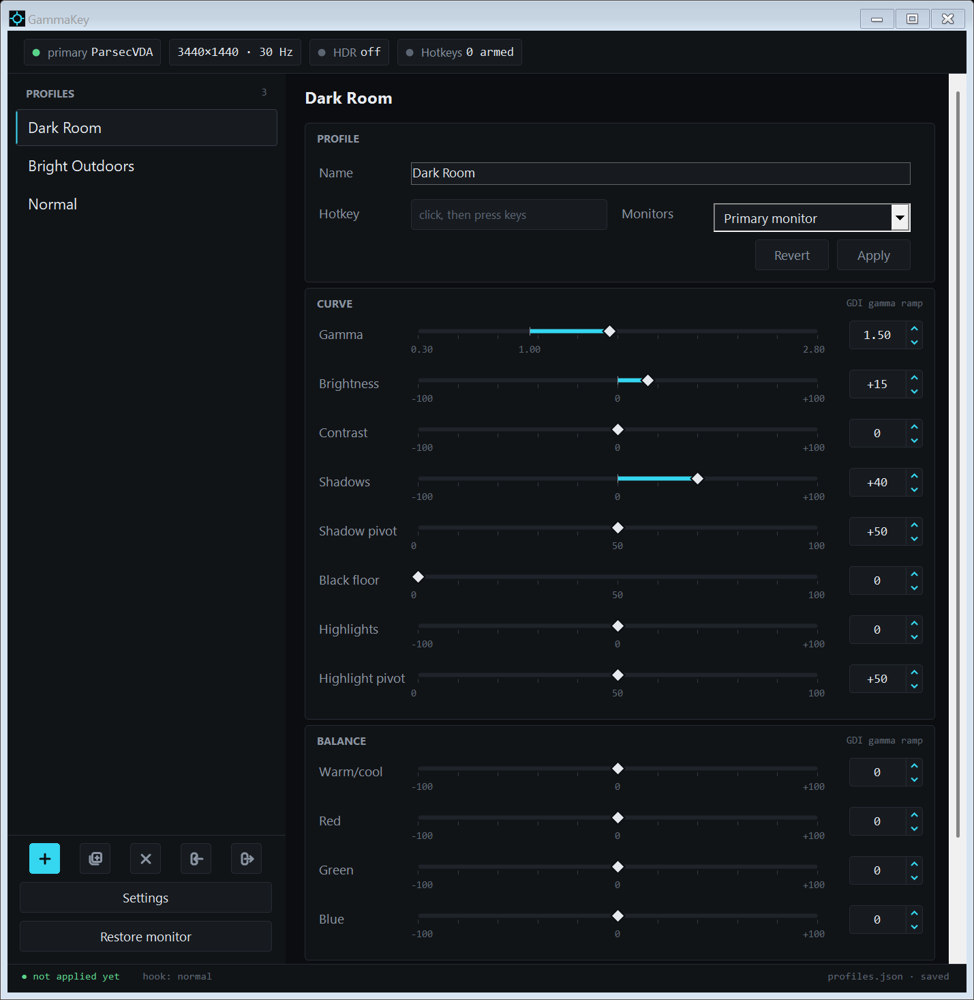

# GammaKey

Hotkey profiles for your monitor's picture on Windows. Save gamma, brightness, contrast, shadows,
highlights, colour balance and NVIDIA vibrance as named profiles and switch between them with a
key, in-game or on the desktop. Lives in the tray, needs no install and no admin rights.

No opening the driver control panel, no fiddling with the monitor's buttons, no lost settings. Allows you 
to save presets for all in game lighting conditions, editing programs, or general monitor adjustment profiles. 



## How it works, and why it is safe

GammaKey changes the colour curve your graphics card applies to the whole screen, the same control
the NVIDIA Control Panel's "Adjust desktop color settings" page uses. It talks only to Windows and
the graphics driver. It never opens, reads, hooks or injects anything into a game. The one
exception is the optional pass-through setting, which installs a system-wide keyboard hook (see
Games and anti-cheat section below.)

## What it's good for

- **Dark games.** A profile that lifts the shadows for night maps and caves, a profile that puts
  the picture back, and a hotkey for each. Works in borderless windowed games without touching the
  game's own settings.
- **Day and night.** Cooler and brighter for daytime, warmer and dimmer in the evening.
- **Photo and video editing.** A neutral profile with nothing exaggerated when you're editing,
  your normal picture when you're not.
- **Shared PCs.** Everyone gets a profile instead of fighting over the monitor's buttons.
- **Multiple monitors.** A profile can target the primary monitor, all of them, or one by name.

## Install

1. Download `GammaKey.exe` from the [latest release](https://github.com/J-Ride/GammaKey/releases/latest).
2. Put it in its own folder. It writes its settings file next to itself.
3. Run it. SmartScreen will probably complain because the exe is unsigned. Click **More info**,
   then **Run anyway**.

**The tool opens to the tray by default so look in your system tray after starting it**

That's it. There is nothing else to install: the exe is self-contained and carries its own .NET 
runtime.

## Requirements

- Windows 10 or 11, 64-bit.
- An NVIDIA graphics card for the **Vibrance** slider. On AMD and Intel cards that slider is
  greyed out for now and everything else works.

## Usage

### Your first profile

1. Click **+** in the left rail, or pick one of the three starter profiles (Dark Room, Bright
   Outdoors, Normal).
2. Drag the sliders. The screen updates as you drag.
3. Click the **Hotkey** box and press a key combination. Backspace clears it.
4. Pick which **Monitors** the profile applies to.
5. Click **Apply** to save. **Revert** drops your edits and reloads the saved profile.

Then go to **Settings** and set a **Restore monitor** hotkey. That key always puts the original
picture back, whatever state you're in.

### Hotkeys

- Hotkeys are global. They work in any app while GammaKey is running.
- Pressing the hotkey of the profile that's already active restores the original picture, so one
  key can toggle.
- A hotkey with no Ctrl, Alt or Shift swallows its key: a profile on `F9` means `F9` no longer
  reaches other apps. Use a modifier, or turn on pass-through in Settings (read the anti-cheat
  note first).
- If another program already owns the combination, the hotkey box says "in use by another app"
  and the status line names the profile.

### The window

- **Left rail:** the profile list with each profile's hotkey. Under it: add, duplicate, delete,
  import, export, then **Settings** and **Restore monitor**.
- **Top strip:** the primary monitor, its resolution and refresh rate, whether HDR is on, and how
  many hotkeys are armed.
- **Editor:** name, hotkey, monitor target, then the sliders.

Selecting a profile in the list applies it. If you switch profiles with unsaved edits, a dialog
asks whether to save or discard them. Closing the window hides it to the tray; **Quit** is in the
tray menu.

### Sliders

| Group | Slider | Range |
|---|---|---|
| Curve | Gamma | 0.30 to 2.80, 1.00 is normal |
| Curve | Brightness, Contrast, Shadows, Highlights | -100 to +100 |
| Curve | Shadow pivot, Highlight pivot | 0 to 100, 50 is normal |
| Curve | Black floor | 0 to 100 |
| Balance | Warm/cool, Red, Green, Blue | -100 to +100 |
| Color | Vibrance (NVIDIA only) | 50 to 100, 50 is normal |

Shadows lifts or crushes everything darker than its pivot; Highlights dims or boosts everything
brighter than its pivot. Move a pivot to change how much of the picture its slider touches: a
Shadow pivot at 25 lifts only the darkest quarter, a Highlight pivot at 0 scales the whole
picture down, which caps how white white can be. Black floor sets the darkest level the screen
shows. Windows refuses a table whose white falls below half, which is where Highlights -100 with
the pivot at 0 lands.

Curve and Balance change the colour table the graphics card applies to the whole screen. Vibrance
is set in the NVIDIA driver and survives alt-tab.

If you push the sliders far enough, Windows refuses the curve. The status line says "Windows
refused this curve, reduce the sliders" and the previous picture stays.

### Tray menu

Right-click the icon for the profile list, **Reset**, **Open GammaKey**, **Start with Windows**
and **Quit**.

### Settings

| Setting | What it does |
|---|---|
| Start with Windows | Runs in the tray at sign-in. This is a Run entry for your user that points at the exe, so if you move the exe, turn it off and on again. |
| Show window on launch | Off means tray only. |
| Show profile name on hotkey | A short toast at the bottom right when a hotkey fires. |
| Re-apply if Windows resets the curve | Every 3 seconds, checks the active curve is still on screen and puts it back if a game or the driver cleared it. On by default. |
| Let hotkeys pass through to other apps | Uses a system-wide keyboard hook instead of Windows hotkeys, so the key also reaches the game. See the anti-cheat note. |
| Restore monitor hotkey | The key that puts the original picture back. |
| Open profiles folder | Opens the folder the exe lives in. |

## Games and anti-cheat

**Run games in borderless windowed mode.** In exclusive fullscreen a lot of games write their own
gamma curve when they get focus, which overwrites GammaKey until the next hotkey press or the next
guard check.

**Anti-cheat.**: GammaKey talks to Windows and the graphics driver only. It does not open, read, hook or inject
anything into a game. The one exception is the optional pass-through setting, which installs a
system-wide keyboard hook. Some anti-cheat systems flag that. If you play anything with anti-cheat,
leave pass-through off and use a modifier on your hotkeys instead. Pass-through also doesn't see
keys from macro software or a Stream Deck, and gets nothing while an admin window has focus.

## Files

Everything lives next to `GammaKey.exe`. The only thing written anywhere else is the optional
Start with Windows registry entry.

| File | Purpose |
|---|---|
| `profiles.json` | Your profiles and settings. Plain JSON. Copy it to another PC or send it to a friend. Written to a temp file and swapped in, so a crash can't leave it half written. |
| `profiles.json.corrupt` | Only appears if `profiles.json` couldn't be read. Your old file is kept here and the app starts with defaults. |
| `baseline.json` | The monitor's original colour table and vibrance, captured at start. |
| `running.lock` | Exists while the app runs. If it's still there at the next start, the last run died with a curve on screen, so the saved baseline is restored first. |

Export writes the same JSON shape as `profiles.json`, one profile or all of them, so an exported
file and a copied `profiles.json` both import. Imported profiles whose hotkey is already taken
arrive with the hotkey cleared.

## Notes

- **HDR.** Tune the sliders with HDR on if you game with HDR on; what you see is what is saved.
- **Flicker in Discord or Chrome** with a curve active is a known NVIDIA driver quirk with custom
  curves. Update the driver, or press Restore monitor while not gaming.
- **Monitor unplugged.** A profile that targets a monitor that is not connected falls back to
  the primary monitor and says so in the status line.

## Build from source

Needs the .NET 8 SDK.

```
dotnet build
dotnet test
.\publish.ps1
```

`publish.ps1` runs the tests, then builds the single self-contained exe into `publish\GammaKey.exe`.

## License

MIT.

