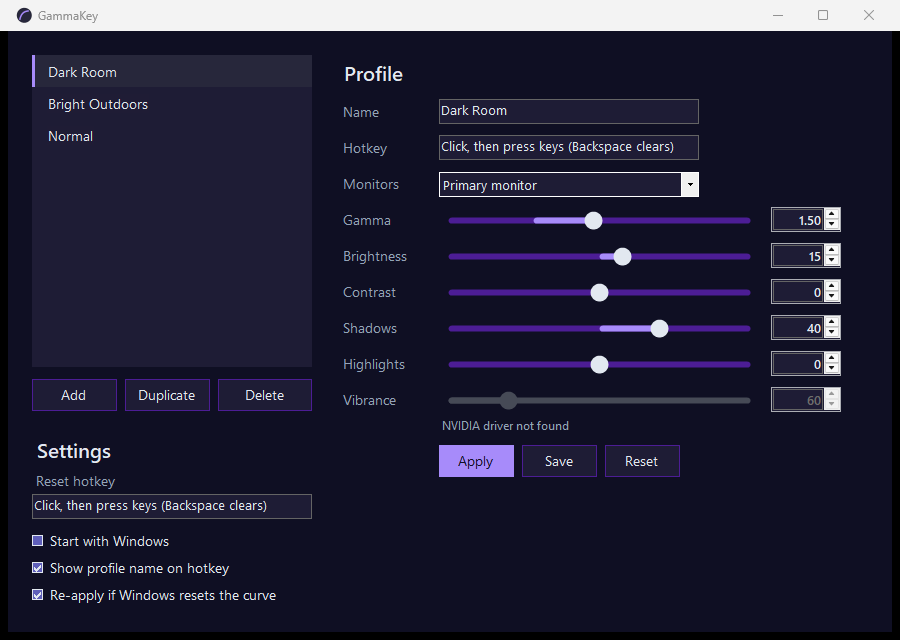

# GammaKey

Switch your monitor's gamma, brightness, contrast, shadows, highlights and NVIDIA vibrance with a hotkey.
Made for Escape from Tarkov's dark corners, works anywhere on the desktop.

## Run it

1. Download `GammaKey.exe` and put it in its own folder (it writes `profiles.json` beside itself).
2. Double-click it. Windows SmartScreen may warn because the exe is unsigned: click **More info**, then **Run anyway**.
3. An icon appears by the clock. Left-click it to open the window.
4. Pick a profile, drag the sliders until the screen looks right, click the **Hotkey** box and press your key combo, then **Save**.
5. Set a **Reset hotkey** in Settings so you can always get back to normal.

Profiles live in `profiles.json`. Copy that file to a friend's folder to share your setup.

## How it works, and why it is safe

GammaKey changes the colour curve your graphics card applies to the whole screen, the same control the
NVIDIA Control Panel's "Adjust desktop color settings" page uses. It talks only to Windows and the graphics
driver. It never opens, reads, hooks or injects anything into a game. It runs without administrator rights.

## Notes

- **HDR.** Tune the sliders with HDR on if you game with HDR on; what you see is what is saved.
- **Vibrance** needs an NVIDIA card. On other cards the slider is greyed out and everything else works.
- **Flicker in Discord or Chrome** with a curve active is a known NVIDIA driver quirk with custom curves.
  Update the driver, or press Reset while not gaming.
- **Original settings** are saved to `baseline.json` on start and restored on Reset, on Quit, and on the
  next start if GammaKey was closed uncleanly.

## Build from source

Needs the .NET 8 SDK.

    .\publish.ps1

Output: `publish\GammaKey.exe`.
